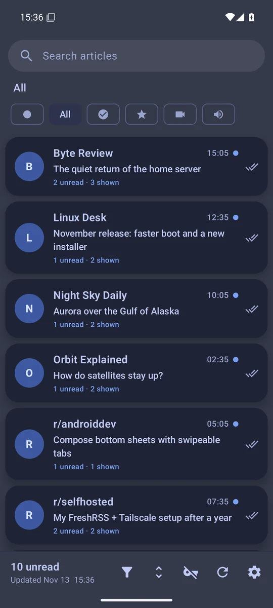
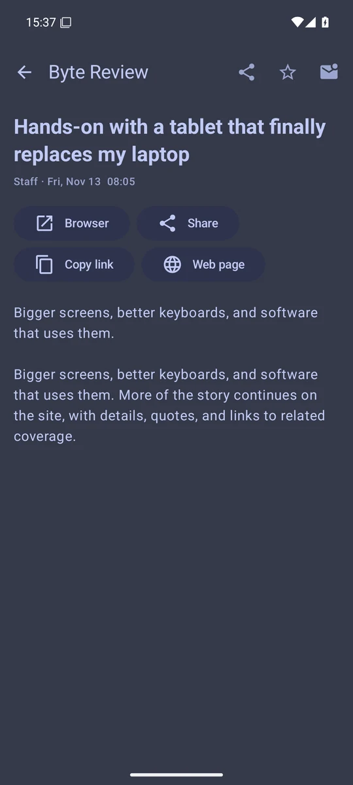
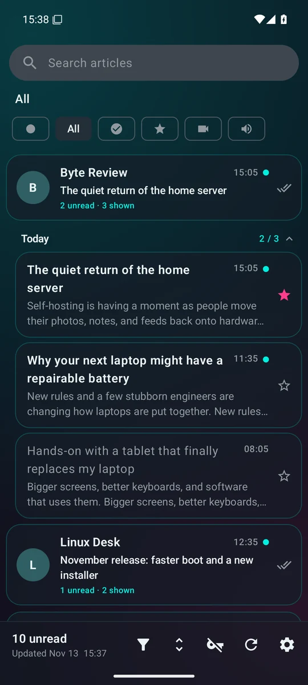
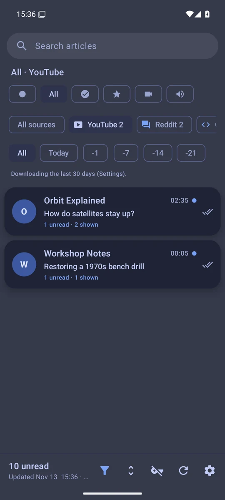
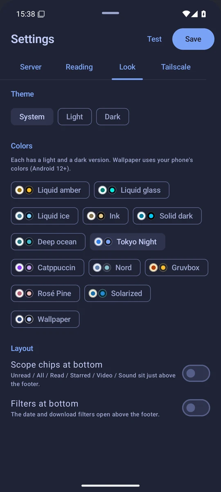
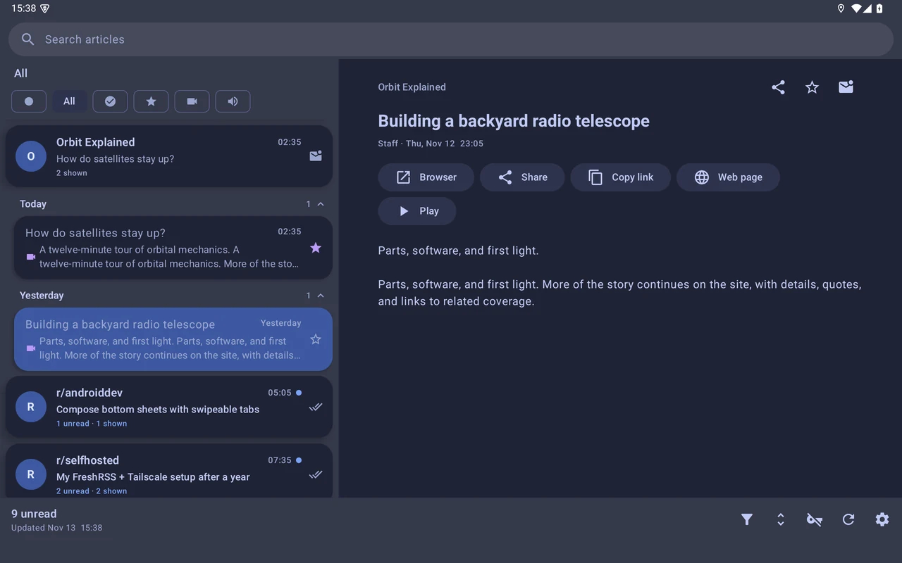

<div align="center">

# FreshRSS Android

A personal Android reader for your own [FreshRSS](https://freshrss.org/) server, and the phone companion to the quickshell FreshRSS widget.

[](https://github.com/crome1394/freshRSS-android/releases/latest)
[](https://github.com/crome1394/freshRSS-android/releases)
[](docs/setup.md)
[](https://kotlinlang.org/)
[](https://developer.android.com/compose)
[](LICENSE)

</div>

Point it at your server (LAN, Tailscale, or HTTPS). No third-party account, no tracking, and articles load no images unless you ask.

<p align="center">
  
  
  
</p>

## Download

Get the APK from **[Releases](https://github.com/crome1394/freshRSS-android/releases/latest)** and sideload it (allow "Install unknown apps").
Coming from 0.7.x? Uninstall it first. 0.8.0 is signed with a new key ([why](docs/setup.md#updating-from-07x)).

## Features

| | |
|---|---|
| **Reader** | Feeds A–Z with site icons → days → articles; Unread / All / Read / Starred; video and sound filters; **source filter** (YouTube, Reddit, …); date filter; search |
| **Article** | Full text with links, lead picture, **web page view** (the site's main text, without the clutter), copy link, share |
| **Actions** | Swipe read/unread, star, whole feed or day read ↔ unread |
| **Media** | Play / Listen opens YouTube, NewPipe, Spotify, and similar apps |
| **Tailscale** | Footer key connects and disconnects the VPN; on mobile data a refresh connects, updates, and disconnects by itself |
| **Look** | Card layout with a search pill and footer; 13 color themes (including the quickshell Liquid and Classic presets and Material You), each light and dark; tablet dual pane |
| **Settings** | Resizable bottom sheet with swipeable Server / Reading / Look / Tailscale tabs |
| **Offline** | Last list cached; one-row home-screen widget with the unread count |
| **Big screens** | Tablet and Fold two-pane layout; Android 8.0+ |

## Screenshots

| Source filter | Settings | Tablet |
|:---:|:---:|:---:|
|  |  |  |

Screenshots use made-up demo feeds from [`tools/mock-freshrss.py`](tools/mock-freshrss.py).

## Quick start

1. In FreshRSS, enable API access and set an **API password** (Profile).
2. Install the APK, enter your server URL, user, and API password, then **Test connection** → **Save**.

## Documentation

| Doc | What's in it |
|---|---|
| [Setup](docs/setup.md) | Server and app setup, Tailscale, widget, updating |
| [Features](docs/features.md) | Every gesture, button, and setting |
| [Building](docs/building.md) | Build from source, signing, making a release |
| [Architecture](ARCHITECTURE.md) | How the app is put together |
| [F-Droid](F-DROID.md) | Reproducible, upstream-signed F-Droid builds (prepared, not submitted) |
| [Changelog](CHANGELOG.md) | What changed in each version |

## Build

```bash
echo "sdk.dir=$HOME/Android/Sdk" > local.properties
./gradlew :app:assembleDebug
```

JDK 17+ and Android SDK 35. More in [Building](docs/building.md).

## License

[MIT](LICENSE) © 2026 Matthew Crome. Not an official FreshRSS product.
